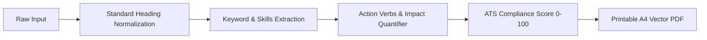

<div align="center">

# 📄 ResumeCraft AI

### Intelligent ATS Resume Builder & Career Copilot

[](https://react.dev/)
[](https://www.typescriptlang.org/)
[](https://vitejs.dev/)
[](https://tailwindcss.com/)
[](LICENSE)

**ResumeCraft AI** is a modern, privacy-first resume builder designed to help job seekers pass **Applicant Tracking Systems (ATS)** like Workday, Greenhouse, Lever, and Taleo. It pairs real-time ATS scoring with a dual-mode AI engine (cloud LLM via 9router + instant local algorithmic fallback) and an authentic 1:1 A4 document canvas.

[✨ Features](#-key-features) • [🚀 Quick Start](#-quick-start) • [🤖 AI Configuration](#-ai-configuration) • [📐 ATS Engine](#-ats-optimization-engine) • [📁 Project Structure](#-project-structure)

</div>

---

## 🌟 Key Features

### 🎯 1. Real-Time ATS Scoring Engine
- **Instant Audit**: Scores your resume on a 100-point scale across 4 core pillars: **ATS Compatibility**, **Quantified Impact (Metrics)**, **Action Verbs (STAR method)**, and **Section Completeness**.
- **Actionable Insights**: Highlights missing sections, passive voice, weak bullet points, and provides instant fix recommendations.

### 🤖 2. AI Career Copilot (Cloud + Local Fallback)
- **Bullet Point Optimizer**: Rewrites passive bullets into high-impact, metric-driven statements starting with commanding action verbs (*Spearheaded, Architected, Accelerated*).
- **Role Bullet Generator**: Generates tailored bullet points based on your target job title and desired keywords.
- **Executive Summary Generator**: Crafts concise, compelling summaries tailored to your years of experience and domain mastery.
- **Targeted Cover Letter**: Synthesizes your resume data into a personalized 3-paragraph cover letter for any job opening.
- **Zero Downtime Fallback**: If the AI gateway is unreachable, ResumeCraft AI smoothly transitions to an offline algorithmic engine with curated power verb libraries.

### 📄 3. True-to-Life 1:1 A4 Document Canvas
- **Dynamic Multi-Page Computation**: Automatically detects content overflow and calculates exact A4 page splits.
- **Visual Page Cutoff Guides**: Clearly displays where each A4 page ends on screen so you never get awkward mid-bullet page breaks.
- **Distraction-Free Fullscreen Mode**: Expand your canvas into a full-viewport editing and review environment.
- **Pixel-Perfect PDF Generation**: Direct 1:1 print stylesheet formatting ensuring your downloaded PDF looks identical to your screen preview.

### 🎨 4. ATS-Compliant Styling & Typography
- **4 Curated ATS Templates**: *Simple* (highest ATS pass rate), *Modern* (accent header), *Compact* (high density), and *Creative* (editorial serif).
- **Distinct Typography**: Switch between **Inter**, **Roboto**, **Merriweather**, **Lora**, and **JetBrains Mono** with authentic font family previews.
- **Granular Layout Sliders**: Precision control over **Font Size**, **Line Spacing**, **Section Spacing**, and **Page Margins**.
- **Curated ATS Color Palette**: High-contrast, machine-readable accent colors + custom hex color picker.

### 🔒 5. Local-First & Privacy Focused
- **Auto-Save to LocalStorage**: Every keystroke is saved locally in your browser. Refreshing or closing the tab will never wipe your work.
- **JSON Import & Export**: Export your resume as a standardized JSON backup and import it back anytime.
- **No Account Required**: Start building immediately without registration, tracking, or subscription paywalls.

---

## 📸 Preview & Workflow

| Dual-Pane Build Workspace | Real-Time ATS Audit |
| :---: | :---: |
| Edit content on the left while watching the pixel-perfect A4 canvas update live on the right. | Comprehensive breakdown of ATS pass probability, metrics density, and actionable fixes. |

---

## 🚀 Quick Start

### Prerequisites
- [Node.js](https://nodejs.org/) (version 18.0 or higher recommended)
- [npm](https://www.npmjs.com/) or [pnpm](https://pnpm.io/) / [yarn](https://yarnpkg.com/)

### Installation

1. **Clone the repository:**
   ```bash
   git clone https://github.com/mashurimansur/resumecraft-ai.git
   cd resumecraft-ai
   ```

2. **Install dependencies:**
   ```bash
   npm install
   ```

3. **Configure Environment Variables:**
   ```bash
   cp .env.example .env
   ```

4. **Start the development server:**
   ```bash
   npm run dev
   ```

5. **Open in your browser:**
   ```
   http://localhost:5173/
   ```

---

## 🤖 AI Configuration

ResumeCraft AI supports any OpenAI-compatible API gateway (such as **9router**, **OpenAI**, **OpenRouter**, or custom local LLM servers).

Edit your `.env` file:

```env
# AI Gateway Base URL (Defaults to 9router or OpenAI)
VITE_AI_BASE_URL=https://9router.codehuri.my.id/v1

# Your API Key
VITE_AI_API_KEY=your-api-key-here

# Target LLM Model (e.g., ag/gemini-3.8-flash, gpt-4o-mini, claude-3-5-sonnet)
VITE_AI_MODEL=ag/gemini-3.8-flash
```

> **Note**: In development mode, Vite's internal reverse-proxy (`/api/9router`) safely forwards requests to avoid CORS and browser header blocks. If no API key is provided, all AI actions seamlessly use the built-in offline algorithmic fallback.

---

## 📐 ATS Optimization Engine

Applicant Tracking Systems scan resumes sequentially. ResumeCraft AI adheres strictly to industry ATS parsing standards:



- **Header Hierarchy**: Single `<h1>` for full name, followed by clean semantic tags (`<h2>`, `<p>`, `<ul>`, `<li>`).
- **No Table/Multi-Column Clutter**: Content flows in a clean single-column structure that ATS parsers parse without character interleaving.
- **Standard Date Formats**: Uses universally recognized date representations (*e.g., "Jan 2022 — Present"*).
- **Clean Vector Icons**: Contact metadata features inline SVG icons that print cleanly without corrupting plaintext scrapers.

---

## 📁 Project Structure

```text
resumecraft-ai/
├── index.html                   # HTML entry point with Google Fonts
├── package.json                 # Project manifest & dependencies
├── postcss.config.js            # PostCSS configuration
├── tailwind.config.js           # Tailwind CSS configuration & custom fonts
├── tsconfig.json                # TypeScript compiler configuration
├── vite.config.ts               # Vite bundler & reverse proxy setup
├── src/
│   ├── App.tsx                  # Root application layout & state manager
│   ├── main.tsx                 # React DOM mount
│   ├── index.css                # Global styles, Tailwind directives & print rules
│   ├── components/
│   │   ├── Header.tsx           # Top navigation, ATS score pill & AI gateway status
│   │   ├── ResumePreview.tsx    # Live 1:1 A4 canvas with dynamic page measurement
│   │   ├── editors/             # Modular section form editors
│   │   │   ├── ContactEditor.tsx
│   │   │   ├── SummaryEditor.tsx
│   │   │   ├── ExperienceEditor.tsx
│   │   │   ├── EducationEditor.tsx
│   │   │   ├── SkillsEditor.tsx
│   │   │   ├── ProjectsEditor.tsx
│   │   │   ├── CertificationsEditor.tsx
│   │   │   └── DesignEditor.tsx
│   │   └── tabs/                # Top-level workspace views
│   │       ├── ScoreTab.tsx     # Comprehensive ATS scoring breakdown
│   │       ├── TargetTab.tsx    # Job description keyword matcher & gap analyzer
│   │       └── CoverLetterTab.tsx # AI cover letter writer
│   ├── data/
│   │   └── sampleResumes.ts     # Pre-loaded executive & developer resumes
│   ├── services/
│   │   └── aiService.ts         # Gateway client, ping test & streaming parser
│   ├── types/
│   │   └── resume.ts            # Complete TypeScript domain interfaces
│   └── utils/
│       ├── atsScorer.ts         # ATS heuristic evaluation engine
│       └── aiAssistant.ts       # Algorithmic offline fallback assistant
```

---

## 🛠️ Built With

- **[React 18](https://react.dev/)** — Declarative UI framework
- **[TypeScript](https://www.typescriptlang.org/)** — Strict type safety and maintainability
- **[Tailwind CSS](https://tailwindcss.com/)** — Utility-first styling with responsive design tokens
- **[Lucide React](https://lucide.dev/)** — Consistent, lightweight vector icons
- **[Vite](https://vitejs.dev/)** — Lightning-fast HMR and optimized production bundling

---

## 📄 License

Distributed under the **MIT License**. See `LICENSE` for more information.

---

<div align="center">

Made with ❤️ for job seekers worldwide. Pass the ATS filter and land your dream job!

</div>
